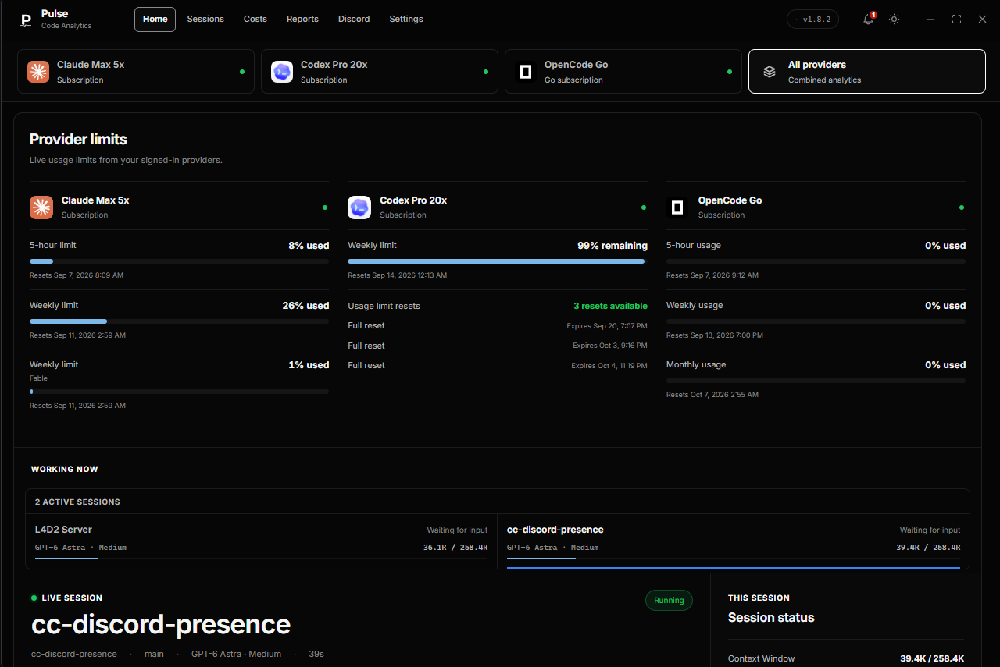

<div align="center">

<h1>
  <picture>
    <source media="(prefers-color-scheme: light)" srcset="assets/pulse-logo-dual-light.png">
    
  </picture>
</h1>
<h2>Your coding activity. One clear view.</h2>
<p>Local-first AI coding analytics and Discord Rich Presence for<br>Claude Code, OpenAI Codex, OpenCode, Command Code and Orion App.</p>

<p>
  <a href="https://github.com/xt0n1-t3ch/Pulse-Analytics/releases/latest"></a>
  <a href="LICENSE"></a>
  <a href="src-tauri/Cargo.toml"></a>
</p>

<p><a href="#installation"> Download</a> &middot; <a href="#preview"> Preview</a> &middot; <a href="CHANGELOG.md"> What's new</a> &middot; <a href="#supported-providers"> Use Pulse</a> &middot; <a href="docs/index.md"> Documentation</a></p>


</div>

## Overview

| Live activity | Provider limits | Discord presence |
| --- | --- | --- |
| See your active project, model and session context. | Read account usage without mixing providers or session tokens. | Choose which application and fields your profile shares. |

Pulse is an open-source desktop dashboard for **Claude Code analytics, OpenAI Codex usage, OpenCode, Command Code and Orion App sessions**. It works as a Claude Code cost tracker, a Codex token counter and a usage monitor for AI coding agents. Track tokens, API-equivalent costs, prompt-cache efficiency, context-window fill and account limits, then share selected live details through Discord Rich Presence.

Live activity, session history and account limits stay separate. Missing prices remain unavailable, not zero. Your session analytics stay on your machine.

<h2 id="preview">&nbsp; Preview</h2>

See provider limits and active sessions in a historical Home view. Select the screenshot to inspect the original capture.

<p align="center">
<a href="assets/evidence/pulse-home-v1.8.2-2026-09-07.png"></a>
<br><sub>Provider limits and live sessions. Pulse 1.8.2 on Windows.</sub>
</p>

<details>
<summary>Explore earlier Discord previews</summary>

These repository captures show earlier Claude and Codex presence layouts. They are historical examples, not screenshots of the current Pulse interface.

<p align="center">
  <a href="assets/screenshots/discord-rich-presence.png"></a>
  <a href="assets/screenshots/codex-discord-rich-presence.png"></a>
</p>

</details>

## Features

- **Live workspace:** project, model, reasoning effort, activity and context-window fill, separate from cumulative session usage.
- **Session history and costs:** searchable history, token categories, prompt-cache efficiency, API-equivalent estimates and provider-reported value with explicit coverage.
- **Provider limits and Accounts:** independent connections and native allowance windows. Removing a Pulse link never signs your coding client out.
- **Reports:** provider-supported analysis, local exports and sensitive excerpts hidden until you reveal them.
- **Discord Rich Presence:** choose one broadcaster, privacy controls, presets, field order and a backend-owned preview.
- **Desktop controls:** dark and light themes, close-to-tray, durable notifications with read/unread and Undo, and Windows Efficiency mode.

See the [changelog](CHANGELOG.md) for released changes and planned work under Unreleased. Pulse 2.0.0 adds Linux support, Claude Haiku 5.5 and GPT-6.1 Terra, keeps everything it writes in `~/.pulse-analytics`, starts no background processes and redraws the interface with Tahoe-style corners. Unreleased work is not a published update.


<a id="use-pulse"></a>

## Supported providers

Start with your existing coding tools:

1. Open Claude Code, Codex, OpenCode, Command Code or Orion App.
2. Launch Pulse.
3. Select a provider, or choose **All providers** for combined analytics.
4. Open **Discord** to choose what your profile shares.

| View | Purpose |
| --- | --- |
| Home | Active sessions, provider limits, cache ratio and the last seven days of activity |
| Sessions | Live sessions and searchable, filtered history |
| Costs | Provider-billed spend and API-equivalent value, with their provenance |
| Reports | Provider-supported analysis and exports |
| Discord | Broadcast application, presets, field order and the backend-owned preview |
| Accounts | Independent provider connections and native allowances |
| Settings | Provider, plan display, appearance, window behavior and data controls |

Choosing a provider changes its workspace context. **All providers** combines analytics without changing the last broadcast application. The **Broadcast from** control in Discord makes publication ownership explicit.

A completed OpenCode session stays in history but leaves the live focus and Discord publisher. **Idle** does not borrow the last model, token count or monetary value. Unknown cost is unavailable; a provider-reported zero is displayed as `$0.00`.

<details>
<summary id="claude-code">Claude Code</summary>

Pulse reads your local Claude Code transcripts and optional statusline data. Review active sessions, token usage, prompt-cache efficiency and cost estimates in one workspace.

Claude subscription limits and Anthropic API access are separate sources. Account limits appear only after a successful provider check. Session tokens do not stand in for your remaining allowance.

The default Claude source root is `~/.claude`; `CLAUDE_HOME` can override it. Subscription checks currently read `.credentials.json` from that root. Keychain-only credentials on macOS are not supported by this reader; local session analytics remain available.

See [plan detection](docs/guides/plans.md), [cost calculations](docs/guides/costs.md) and [troubleshooting](docs/guides/troubleshooting.md).

</details>

<details>
<summary id="codex">Codex</summary>

Pulse reads local Codex sessions and runtime metadata. Inspect the model, reasoning effort, context usage and recorded activity without combining them with Claude or OpenCode metrics.

Codex subscription limits and OpenAI API access remain separate. Pulse preserves provider-reported limit windows and marks unavailable costs or limits instead of inventing values.

The Codex integration uses `CODEX_HOME`, or `~/.codex` by default. **All providers** combines analytics without changing the application selected for Discord broadcasting.

See the [Codex model catalog](docs/models/codex.md), [context tracking](docs/guides/context.md) and [core integration](docs/maintainers/codex-core.md).

</details>

<details>
<summary id="opencode-and-go">OpenCode and Go</summary>

Pulse reads `opencode.db` and channel databases from OpenCode's local data directory. It supports both message-table schemas and respects `XDG_DATA_HOME` and `OPENCODE_DB`. Additional databases can be set in `~/.pulse-analytics/config/opencode.json`.

When an existing OpenCode Go credential is available, Pulse requests its account usage from the Go API. Pulse does not copy that credential into its own settings or logs. The monthly window uses the provider's reset date rather than an invented fixed duration.

Desktop, CLI and OpenChamber can share this local store. Unknown client attribution remains OpenCode; a managed OpenChamber label requires matching process identity. Remote stores on other machines are outside this local integration. Read the [OpenCode and Astra guide](docs/guides/opencode.md) for the source and absence rules.

</details>

<details>
<summary id="command-code">Command Code</summary>

Pulse reads Command Code CLI and Desktop sessions through one collector, with the costs Command Code reports and one Discord identity. Account limits come from the authenticated Command Code API. Read the [Command Code guide](docs/guides/command-code.md).

</details>

<details>
<summary id="orion-app">Orion App</summary>

Pulse reads the Orion App session store read-only. It shows the model and reasoning level, the live tool activity, tokens, context fill and subagents. Orion records no billed amount, so Pulse calculates session cost from exact token counts at published per-model rates, with the same per-category breakdown as Claude Code, and leaves it unavailable for a model with no known rate. Read the [Orion App guide](docs/guides/orion.md).

</details>

<details>
<summary id="discord-controls">Discord controls</summary>

Open Discord, choose a broadcast application in Pulse, and enable Rich Presence. Use **Minimal**, **Standard** or **Full**, then adjust individual fields. OpenCode defaults to model, activity, project and branch before its numeric fields. Field order controls priority within each Discord line.

Unavailable fields stay disabled. Go quotas identify Go explicitly and appear only while their data is fresh and the field is enabled. The profile preview uses the same Rust compositor as the publisher. The connected user's name and avatar come from local Discord IPC; an unavailable banner is not fabricated.

</details>

<details>
<summary id="notifications">Notifications</summary>

The bell opens the local notification history. You can mark one item or all items as read/unread, dismiss an item, or clear the list. **Clear all** requires confirmation and preserves the records. **Undo** restores the last confirmed clear and its original read states. The last Undo receipt survives an app restart on the same client.

If Pulse cannot refresh the history, it labels the retained snapshot and disables bulk changes until the connection recovers.

</details>

<details>
<summary id="windows-efficiency-mode">Windows Efficiency mode</summary>

Pulse requests EcoQoS and Idle process priority at startup. Windows owns the Task Manager leaf indicator; Pulse does not draw a substitute. Other operating systems keep their normal scheduling behavior.

Set this environment variable before launch to opt out:

```powershell
$env:PULSE_EFFICIENCY_MODE = "0"
```

See [Windows Efficiency mode](docs/maintainers/windows-efficiency.md) for behavior and the read-only verification command.

</details>

## Requirements

Use the package for your operating system and architecture. Pulse targets Windows, macOS and Linux, with x64 and ARM64 release packages. Availability of an asset is separate from installed-window acceptance; see [platform verification](docs/maintainers/platforms.md).

- **Windows:** Microsoft Edge WebView2.
- **macOS:** macOS 11.0 or later as configured by the application. GitHub packages are not Apple Developer ID signed or notarized.
- **Linux:** GTK 3 and WebKitGTK 4.1. Install `libayatana-appindicator` for the system tray. Tray availability varies by desktop environment.
- **Providers:** existing local Claude Code, Codex, OpenCode, Command Code or Orion App data. Supported credentials and a successful provider check are required for allowance cards, not for local history.
- **Discord:** a running desktop client for Rich Presence; analytics do not require Discord.


## Installation

<a id="install"></a>

Choose an installer for your operating system and architecture from [GitHub Releases](https://github.com/xt0n1-t3ch/Pulse-Analytics/releases/latest).

| Platform | v2.0.0 downloads | Installer formats |
| --- | --- | --- |
| Windows | [x64](https://github.com/xt0n1-t3ch/Pulse-Analytics/releases/download/v2.0.0/pulse-windows-x64-Pulse_2.0.0_x64-setup.exe) · [ARM64](https://github.com/xt0n1-t3ch/Pulse-Analytics/releases/download/v2.0.0/pulse-windows-arm64-Pulse_2.0.0_arm64-setup.exe) | `.exe` (NSIS), `.msi` |
| macOS | [Intel](https://github.com/xt0n1-t3ch/Pulse-Analytics/releases/download/v2.0.0/pulse-macos-x64-Pulse_2.0.0_x64.dmg) · [Apple Silicon](https://github.com/xt0n1-t3ch/Pulse-Analytics/releases/download/v2.0.0/pulse-macos-arm64-Pulse_2.0.0_aarch64.dmg) | `.dmg`, app archive |
| Linux | [x64](https://github.com/xt0n1-t3ch/Pulse-Analytics/releases/download/v2.0.0/pulse-linux-x64-Pulse_2.0.0_amd64.AppImage) · [ARM64](https://github.com/xt0n1-t3ch/Pulse-Analytics/releases/download/v2.0.0/pulse-linux-arm64-Pulse_2.0.0_aarch64.AppImage) | `.deb`, `.rpm`, `.AppImage` |

macOS GitHub packages are not Apple-signed or notarized. macOS may block first launch. Updater signatures are separate from Apple signing.

The [v2.0.0 release](https://github.com/xt0n1-t3ch/Pulse-Analytics/releases/tag/v2.0.0) contains all six targets. The links above select NSIS, DMG or AppImage; MSI, DEB and RPM alternatives are on the release page. Native build/test checks and installed-GUI acceptance are recorded separately per operating system. See [platform verification](docs/maintainers/platforms.md).

Every complete release must include `SHA256SUMS.txt`, Windows software bills of materials and `latest.json` with signed updater payloads for all six targets. Do not install an asset for a different architecture to work around a missing download.

<details>
<summary>Windows installation</summary>

Download the matching `.exe` or `.msi`, compare its SHA-256 hash with `SHA256SUMS.txt`, then run the installer. Pulse uses Microsoft Edge WebView2. Windows Efficiency mode is specific to Windows.

Asset names include the platform and architecture, such as `pulse-windows-x64-Pulse_2.0.0_x64-setup.exe`. Each Windows architecture has its own SPDX file.

</details>

<details>
<summary>macOS installation</summary>

Download the Intel or Apple Silicon `.dmg`, verify its checksum and drag Pulse to Applications. The configured minimum is macOS 11.0.

These GitHub packages have no Apple Developer ID signature or notarization. Keep system security controls enabled; the native build checks do not establish Gatekeeper acceptance.

</details>

<details>
<summary>Linux installation</summary>

Verify the checksum and install the package for your distribution and architecture. Debian-based systems use `.deb`; RPM-based systems use `.rpm`. AppImage is the standalone packaging option, not a promise of compatibility with every distribution.

### Arch Linux and CachyOS

The repository provides a [PKGBUILD](packaging/aur/pulse-analytics-bin/PKGBUILD) that repackages the release `.deb`. It is not a published AUR listing. Review the recipe, then run from your repository checkout:

```bash
cd packaging/aur/pulse-analytics-bin
makepkg -si
```

The package depends on `webkit2gtk-4.1`, `gtk3` and `libayatana-appindicator`. Update it through the package manager, not the in-app updater.

### Other Linux distributions

Use the release `.deb`, `.rpm` or `.AppImage` matching your architecture and verify `SHA256SUMS.txt`. Install the AppIndicator library for tray integration. AppImage updates remain available when launched as an AppImage; package-manager installations use their package manager.

</details>

## Updating

Use the signed in-app updater only when it is available for your installation, or download the matching package from [Releases](https://github.com/xt0n1-t3ch/Pulse-Analytics/releases/latest). On Linux, package-manager installs (pacman/AUR, DEB and RPM) must update through the package manager; AppImage uses the in-app updater. See [updates](docs/guides/updates.md).

Back up the executable, configuration and database through SQLite Backup before replacing an installation. Pulse 2.0.0 uses analytics schema 7, Claude config schema 6 and Codex config schema 13. Returning to Pulse 1.8.2 requires its pre-schema-7 database backup; preserve the newer database separately. Orion App settings live in `config/orion.json`. See [storage and recovery](docs/guides/storage.md).

## Removal

Quit Pulse, including its tray process, then uninstall it with the operating system's uninstaller or the package manager that installed it. For AppImage, remove only the downloaded application file. Provider clients, transcripts and credentials are independent and must not be removed with Pulse.

Pulse-owned history and settings remain under `~/.pulse-analytics` or your `PULSE_HOME`. Keep a consistent backup before choosing to remove that data. Uninstalling Pulse is not a provider sign-out.


<h2 id="your-data-and-network-access">&nbsp; Your data and network access</h2>

Pulse writes only inside `~/.pulse-analytics/` (or `PULSE_HOME`), in `config/`, `data/`, `accounts/`, `cache/`, `state/`, `logs/` and `webview/`. Agent folders such as `~/.claude` and `~/.codex` are read, never written, and no program runs in the background. The first startup moves older layouts into these folders and removes the Pulse files earlier releases left in `~/.claude`. See [storage and recovery](docs/guides/storage.md).

Network use is limited to the configured provider quota checks, release/update checks and the Discord presence fields you enable. Project, branch and activity controls determine what the presence exposes. Keep private prompts, credentials and local reports out of public issues.

On Windows, WSL session discovery is off by default. Enable it only when you need those transcript roots:

```powershell
$env:CC_PRESENCE_INCLUDE_WSL = "1"
```

## Project structure

```text
Pulse-Analytics/
├── src/                 Core library, provider collectors and Claude daemon
├── src-tauri/           Tauri desktop host, SQLite and native commands
├── frontend/            Svelte 5 interface
├── xtask/               Rust checks, documentation and release tooling
├── packaging/           Distribution packaging, including the Arch recipe
├── tests/               Unit, integration, component and contract tests
├── docs/                Guides, model references and implementation contracts
├── assets/              Branding and accepted historical evidence
└── .github/             Manual workflows and repository metadata
```


## Development

Install Rust 1.99.1, Bun 1.4.4 and the [Tauri platform prerequisites](https://v2.tauri.app/start/prerequisites/). Linux development uses clang and mold; Windows uses rust-lld. Install cargo-nextest for Rust tests. Run all commands from the repository root:

```bash
git clone https://github.com/xt0n1-t3ch/Pulse-Analytics.git
cd Pulse-Analytics
bun install
cargo xtask check
bun run build:portable
```

| Purpose | Command |
| --- | --- |
| Install JavaScript dependencies | `bun install` |
| Browser development with real Rust data | `bun run dev` |
| Native development window | `bun run dev:tauri` |
| Installers for this OS | `bun run build` |
| Portable application | `bun run build:portable` |
| Type check (bun check and svelte-check) | `bun run typecheck` |
| Lint (oxlint) | `bun run lint` |
| Format / check format | `bun run fmt` / `bun run fmt:check` |
| JavaScript tests | `bun run test` |
| Rust tests | `cargo nextest run --workspace` |
| Release-script tests | `cargo nextest run -p xtask` |
| Full local gate | `cargo xtask check` (also `bun run verify`) |
| Generate / check llms files | `cargo xtask llms` / `cargo xtask llms --check` |
| Check changelog / extract release notes | `cargo xtask changelog check` / `cargo xtask changelog notes <version>` |
| Check / apply GitHub description and topics | `cargo xtask meta --check` / `cargo xtask meta --apply` |
| Codex catalog parity | `cargo xtask catalog-parity` |
| Release build and assets | Manual release workflow: `cargo xtask release-assets`, `cargo xtask platform-assets` |
| Claude daemon diagnostics | `cargo run -p cc-discord-presence -- status` / `cargo run -p cc-discord-presence -- doctor` |

The portable build embeds its frontend through Tauri; a raw Cargo GUI build may still point at the development URL. The authenticated loopback [development bridge](docs/architecture/dev-bridge.md) renders real Rust data and is not required by an installed application.

Pulse follows [Semantic Versioning](https://semver.org/spec/v2.0.0.html), [Keep a Changelog](https://keepachangelog.com/en/2.0.0/) and [Conventional Commits](https://www.conventionalcommits.org/en/v1.0.0/). Start with the [documentation index](docs/index.md), [test map](tests/index.md), [llms.txt](llms.txt) and [contributing guide](CONTRIBUTING.md). The [release procedure](docs/maintainers/releases.md) keeps checks, publication and native runtime acceptance separate. Report security issues through [private advisories](https://github.com/xt0n1-t3ch/Pulse-Analytics/security/advisories/new).


## FAQ

<a id="common-questions"></a>

Common questions about Pulse.

### Is Pulse a Claude Code cost tracker or a Codex dashboard?

Both, plus OpenCode, Command Code and Orion App. Each provider has its own data source, context rules and cost provenance. The combined view does not merge account allowances or treat subscription credits as API spend.

### Does Pulse need a separate account or API key?

Local session history does not need a Pulse account. Provider quota cards use existing supported credentials and require a successful provider check. Missing credentials do not erase local history. See [plans and access](docs/guides/plans.md).

### Does Pulse upload my prompts?

No. Pulse does not upload your prompts or session transcripts and sends no analytics telemetry. Your session analytics remain local.

Enabled provider quota checks, update checks and Discord presence use the network without uploading transcripts. See [your data and network access](#your-data-and-network-access).

### Are the cost estimates my actual bill?

Not always. Pulse separates provider-reported value from API-equivalent estimates. Prices can change; unknown cost remains unavailable. See [cost provenance](docs/guides/costs.md) before using estimates for a budget.

### Is the Arch package on the AUR?

Not yet. The repository carries a PKGBUILD for local `makepkg -si` installation. Do not assume an AUR package exists.

### Why is the Linux tray missing?

Install `libayatana-appindicator` and check whether your desktop supports AppIndicator trays. Missing tray support must not be confused with missing session data. See [troubleshooting](docs/guides/troubleshooting.md).

### Does All providers change my Discord broadcaster?

No. Combined analytics preserve the broadcaster selected in Discord. Accounts connections are also independent of both selections.

### Is the headless daemon a Codex CLI?

No. `cc-discord-presence` is the Claude daemon. The standalone [Codex Discord Rich Presence](https://github.com/xt0n1-t3ch/Codex-Discord-Rich-Presence) project has its own terminal interface and releases; Pulse consumes its shared core 2.0.1 through an immutable Git pin.


## License

[Apache-2.0](LICENSE), copyright 2026 xt0n1-t3ch. Redistributed and derivative versions must preserve the license, copyright notice and [NOTICE](NOTICE) attribution.
